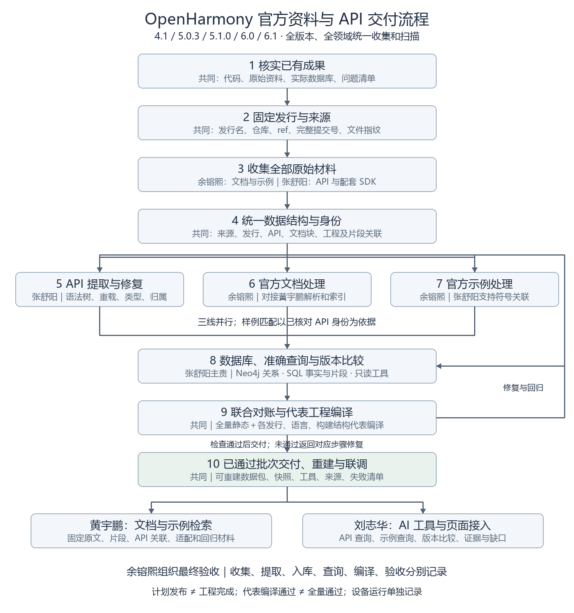
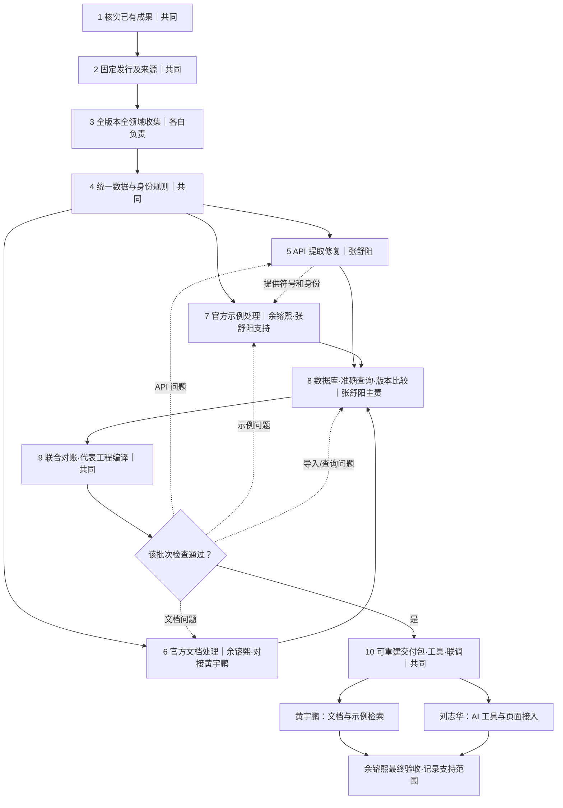

# 余镕熙与张舒阳工作计划：官方资料、API 提取、数据库与下游交付

日期：2026-10-11。状态：计划已确认，实施与验收按各步骤实际结果记录。本文的任务列表不表示已经完成。

## 一、目标与分工

完成 OpenHarmony **4.1、5.0.3、5.1.0、6.0、6.1** 的官方资料收集、结构化处理、准确查询与可复现交付，为黄宇鹏的文档检索和刘志华的 AI 接入提供数据与工具。

- **余镕熙主负责：**官方文档、官方应用示例的获取、来源核对、处理与验收；组织最终交付。
- **张舒阳主负责：**ArkTS/JS 与 Native/C API 源码获取、提取修复、数据库导入、只读查询与版本比较。
- **共同负责：**版本对应、数据身份规则、跨资料关联、对账、问题修复和交付验证。
- **与黄宇鹏衔接：**提供固定来源的文档与示例资料、关联数据、失败样本和核对报告，配合修复现有文档解析及索引。
- **与刘志华衔接：**提供真实数据、只读查询工具、接口说明和联调案例。

全部目标版本、全部领域统一收集和扫描，不以 HTTP 为先行领域；按结构验证和修复处理程序，通过检查的数据分批交付。

## 二、流程图

步骤 1—4 建立共同基础；步骤 5—7 并行处理 API、文档与示例；通过检查的批次进入步骤 8—9。验证发现的问题返回对应处理步骤修复，重新检查后交付。部分批次可先联调，但不能把代表工程编译通过或程序执行结束当成全量验收。

## 三、按步骤执行

### 步骤 1：核实已有成果，建立共同工作基线

**负责人：共同。**

1. 阅读总体计划、数据规范、协作规范和工作计划；核对当前代码提交、实际数据及未提交修改。
2. 张舒阳清点四版本 API 文件：来源仓库、下载方式、目录范围、Git 提交记录及接口资料完整性。
3. 余镕熙清点已有文档和示例，复用官方文件清单与固定来源，避免重复下载和建设。
4. 纳入实际 RAG 核对问题：属性归属丢失、主键覆盖、FTS 重复及正文错配、零切块文档。
5. 复核 API 与 Neo4j 的重载、可选参数、对象分类、同名成员、来源字段及无结果查询；历史记录只作为检查线索。
6. 建立共同任务记录，分别标记待处理、已处理、已验证、待验收；获得结果后立即更新 workplan。

**完成条件：**明确可复用成果、来源不明材料和待重建结果，保留队友修改。

### 步骤 2：固定发行版本及各仓库来源

**负责人：共同；各自记录自己收集资料的来源。**

1. 建立五发行版本表，区分官方发行名、API Level、SDK 包版本和内部标签。
2. 每份资料保存平台、发行名、仓库、分支/标签、完整提交号、获取时间、归档/文件指纹、许可及处理范围。
3. API、文档、示例分别固定提交，依据官方发行配套关系对应，不要求不同仓库 SHA 相同。
4. 优先正式发行标签；缺少标签时固定发行分支提交，并标记为维护快照。
5. 历史资料通过路径与指纹寻找候选；相同候选保留歧义，不靠目录名证明来源。不能确认的原件保留，另取可追溯快照正式处理。
6. 保留 6.0.0.1 Release 和 6.1 LTS 真实身份；对应源码未核实前不混入 6.0/6.1 数据。
7. master 如收集则独立标记开发快照，不能填补正式发行证据。

**完成条件：**正式输入可重新取得并核验，跨资料对应有依据，未知项有清单。

### 步骤 3：统一收集原始材料

**负责人：余镕熙负责文档和示例；张舒阳负责 API 与 SDK。**

1. 收集 ArkTS/JS 声明、Kit 导出、模块入口和官方 Native/C 接口头文件，核对 SDK 导出范围，排除内部实现与公开 API 的混淆。
2. 保存中文 API 参考、开发指南、权限/SysCap、错误码、FAQ、工具/测试说明、发行说明和变更说明。
3. 收集完整示例工程：README、源码、配置、依赖、构建文件、测试、资源与许可。
4. 保留图片和相对链接依赖；图片不作为接口语义提取结果。
5. 下载由来源清单驱动，支持缓存、重试、指纹验证和继续执行；目录变化、缺文件、解码失败进入报告。
6. 原始资料存于本地/团队资料存储，提供获取位置和校验信息，不把全部上游材料塞入 Git 历史。

**完成条件：**每份目标输入有已取得、明确不存在或失败状态；目录清点与正文下载独立记录。

### 步骤 4：约定统一数据结构与身份规则

**负责人：共同；下游核对使用约定。**

1. 来源、发行、API、文档块、工程和片段分别编号，用明确关联字段连接，不靠名称或模糊文本拼接。
2. API 身份包括平台、发行、模块、完整所属层次、对象种类和必要签名区分；不同模块/类/重载不覆盖。
3. 原始声明与规范化结构并存，不抹掉类型、参数顺序、可选性与条件。
4. 保存签名、参数、返回、属性、枚举、相关类型、since、废弃、权限、SysCap、公开/系统标记和证据。
5. 缺失为未知，不自动解释为无权限、全设备支持或无变化。
6. 证据定位到仓库、提交、路径与行号/章节；模型解释另存依据和生成信息。
7. 新旧身份建立迁移映射；旧编号有歧义时明确返回歧义。

**完成条件：**双方和下游共用字段约定，示例能准确关联目标发行 API。

### 步骤 5：修复 API 提取，完成全量结构化处理

**负责人：张舒阳；余镕熙参与对账。**

1. ArkTS/JS 用语法树；Native/C 用配套 SDK 头文件及编译配置的 Clang。宏、条件编译和不支持结构保留原文及状态。
2. 提取函数、方法、类、接口、属性、枚举、类型别名、命名空间、结构体、回调及相关类型；独立保留重载。
3. 正确处理归属、导出、别名、泛型、可选性和参数顺序，不靠关键词判类型。
4. 声明与注释分别解析，保留附着位置和条件版本，不猜行为与替代关系。
5. 全版本扫描，按声明结构建立回归样本，修共性规则而非按 API 名打补丁。
6. 检查文件覆盖、解析失败、身份冲突、导出遗漏及类型引用，逐项抽查原文。
7. 输出结构化数据、报告和未解析清单；运行成功或数量相同不等于完整。

**完成条件：**交付批次无已知静默覆盖，关键结构对账通过，未处理项可定位。

### 步骤 6：处理官方文档，交接现有 RAG 工作

**负责人：余镕熙；现有解析与 FTS 修复对接黄宇鹏。**

1. 建立发行与资料类型分类，检查链接、编码、标题和对应源码。
2. 参考、指南、错误码、权限和发行变更分别适配，不假定通用规则覆盖所有结构。
3. 将 audio.state、socket.clientId、netHandle、一级标题常量/错误码等实际失败样本交为回归输入。
4. 核对归属、完整签名、表格和示例；无法结构化时整文档兜底或明确排除，禁止静默零块。
5. 以模块、完整成员名、种类及签名对应 API；不能确认时保留候选。
6. 源码与文档冲突保留双方证据，先查发行/快照，再判断解析或官方资料差异。
7. 修复后在新库核对主键、切块和索引正文一致性，保留旧库，不只删除重复索引掩盖覆盖。

**完成条件：**固定原文、清单、关联和失败样本可交付；实际 RAG 通过范围有证据，未修项明确。

### 步骤 7：处理全部官方应用示例

**负责人：余镕熙；张舒阳支持 API 身份与解析。**

1. 识别工程/模块根目录，提取功能、领域、应用模型、SDK、设备、权限、依赖和构建方式，不将每份 README 算作 App。
2. 全量扫描导入/使用位置：TS 用语法树；ArkTS 用对应 SDK 解析器；Native/C 结合编译配置。
3. 处理别名、Kit 导出、类型和封装；不能确定接口/重载时留候选。
4. 提取所在函数、创建、配置、权限、事件、错误处理与释放等必要上下文。
5. 区分调用、属性访问和类型引用，不将文本顺序当运行顺序，不承诺静态扫描覆盖所有运行路径。
6. 大模型基于代码和对应文档解释；事实/推断分开，结论附出处，相同内容复用解释并保留版本关系。
7. 检查全量状态、片段、关联、跨版本误连和无依据解释；模型不可用标记未生成，不阻断事实处理。
8. 区分示例要求与 API 要求；缺示例不代表接口不支持。

**完成条件：**每个工程有处理记录，可检索对应发行、有上下文、有出处的片段。

### 步骤 8：导入数据库，建立准确查询与版本比较

**负责人：张舒阳；余镕熙核对关联。**

1. 提取结果作为重建输入；Neo4j 保存结构、类型引用、版本对应和确认的示例关系；SQL 保存示例、片段、解释和验证状态。
2. 复用 SQLite/FTS 文档体系，示例用独立表或可交付库，经统一编号关联。
3. 必须显式指定目标实例和输入范围，在隔离库验证，不沿用清空共享默认库的入口。
4. 对账身份、字段、关系、重复导入和版本隔离；区分处理计数与实际存储计数。
5. 跨版本结合完整身份、签名和官方说明对应；同名不自动等价，不猜重命名/替代关系。
6. 比较新增/删除、签名、重载、可选性、返回、权限、SysCap、公开范围和废弃；核实双端范围后才判新增/删除。
7. 返回双方出处和未知项，区分字节、声明、行为变化和运行兼容性。
8. EVOLVES_TO 只用于确认的版本对应，不将所属、类型引用或版本对应当调用关系。

**完成条件：**数据无损可查，导入不覆盖不同声明，差异方向、对应和证据正确。

### 步骤 9：代表工程编译与联合验证

**负责人：共同。**

1. 全量静态处理后，各发行实际存在的 ArkTS/JS、Native/C、Stage/FA 和不同构建结构至少选一个代表工程；一个工程可覆盖多项。
2. 固定 SDK、工具链、依赖和架构，记录步骤、产物和错误，不为编译成功悄悄升级版本。
3. 按输入、提取、数据库和查询逐层对账，检查实际使用关联到正确声明。
4. 回归覆盖同名对象、重载、可选性、嵌套类型、C 宏/条件、无二级标题、索引错配、重复导入和版本隔离。
5. 比较验证正反方向、重载、缺一端证据、未确认对应和限定范围的增删。
6. 查询验证中文、完整名称、特殊字符、无结果、未知版本、系统接口过滤和错误。
7. 未编译明示未编译，代表成功不推广为全量成功；设备运行单独记录，不作为本次必需条件。
8. 不预设成功率，交付覆盖、失败、耗时和待处理项，有已知缺陷不能标已验收。

**完成条件：**交付批次通过相应检查，编译结果可复现，缺口明确。

### 步骤 10：交付黄宇鹏和刘志华，完成联调与验收

**负责人：共同；余镕熙组织验收。**

1. 黄宇鹏接收固定文档、示例片段、来源/版本表、API 关联、结构分类、失败样本和核对报告。
2. 刘志华接收搜索、详情、使用条件、相关类型、版本比较、示例查询工具；文档搜索与黄宇鹏接口衔接。
3. 参数包括平台、发行、身份/搜索条件；返回来源、覆盖和未知项。参数化只读查询，默认20条、最多100条、数据库查询超时10秒，可配置。
4. 无匹配返回空，范围未支持/对应不明返回缺口，不随机推荐或拿最新发行代替目标发行。
5. 包含代码/依赖、数据、快照、来源/指纹、导入/查询/恢复说明、验证和失败清单；大原文另附位置。
6. 在干净环境重建，再与两位成员联调名称、功能、类型、示例、比较和缺证据场景。
7. 代码、规范、小型回归样本和报告走任务分支与 PR；原始大资料、运行目录及凭据不入 Git，合并须明确授权。
8. 支持清单区分收集、提取、入库、查询验证、编译和下游验收；执行自查与最终验收分开。

**完成条件：**下游可独立取得、重建和调用，并核对出处；范围、剩余项和维护方式明确。

## 四、推进顺序与范围约定

- 1—4 先统一基线与字段，收集并行；5—7 并行处理，通过批次进入8—9，最后10交付。
- 已通过批次可先联调；完整交付包含全目标范围的状态及失败清单。
- 全领域收集与扫描；结构样本用于验证，不缩减收集范围。
- 包括 ArkTS/JS、Native/C、代表编译、可重建包和工具；不包括共享服务器部署、全量设备运行、自动迁移和完整 AI 页面实现。
- 黄宇鹏、刘志华保持检索和 AI 职责；双方负责输入资料、接口数据、查询工具及联合核对。

## 五、状态和交接

本计划保存在 GitHub，不另行更新飞书；不覆盖原有完成记录，不将计划发布当工程完成。实际工程进度以仓库 workplan 及证据为依据，由余镕熙确认最终验收。

新对话读取本计划、协作规范与来源/数据库核对报告；交接记录当前步骤、输入和代码提交、未提交修改、验证、阻塞及下一步，不含凭据与私人通信路径。
